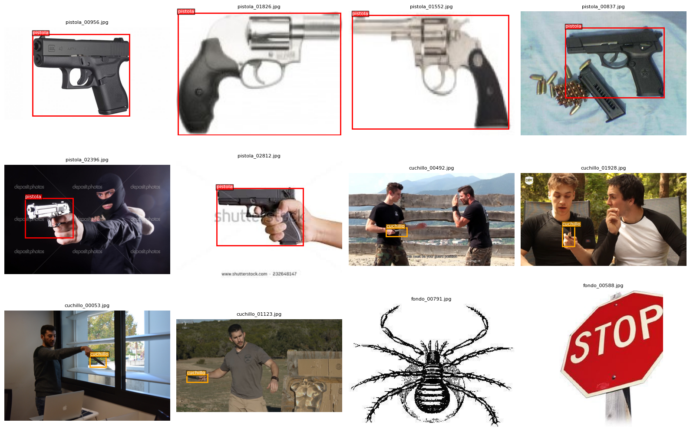
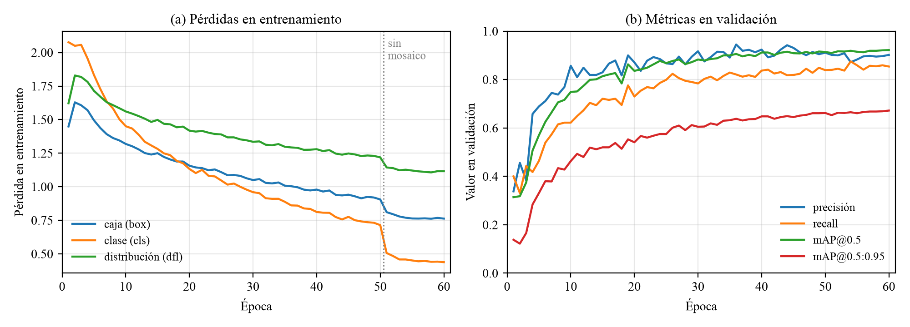
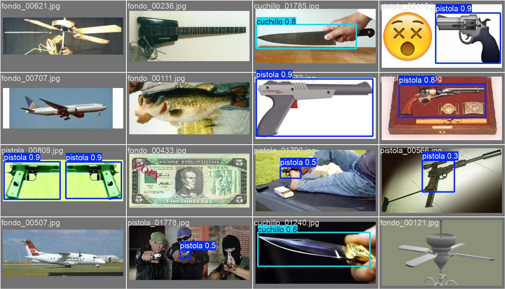
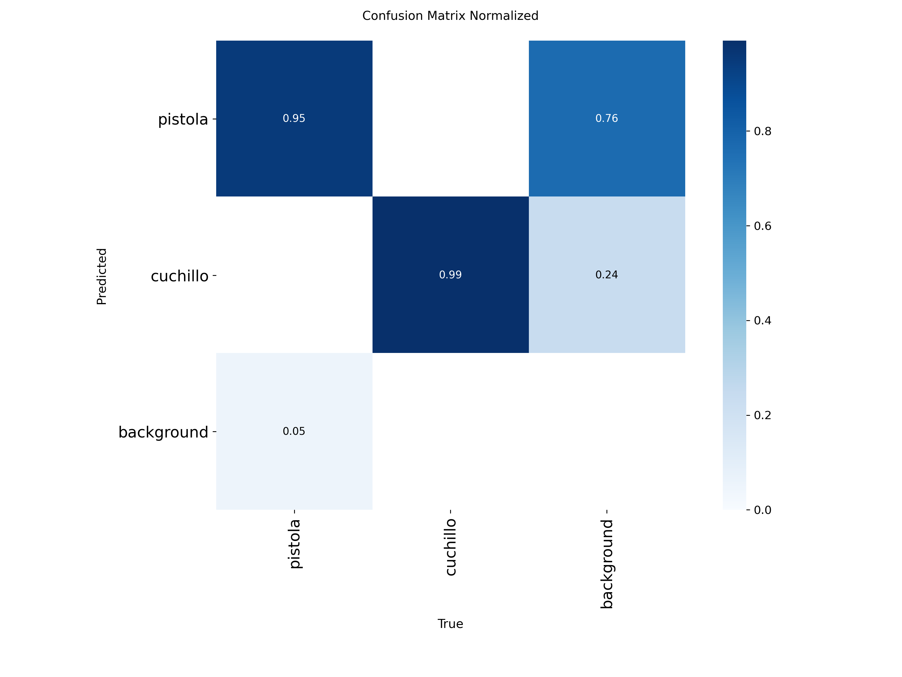
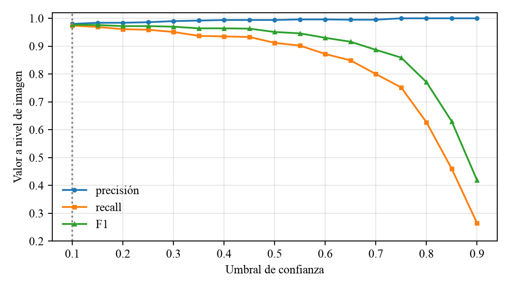
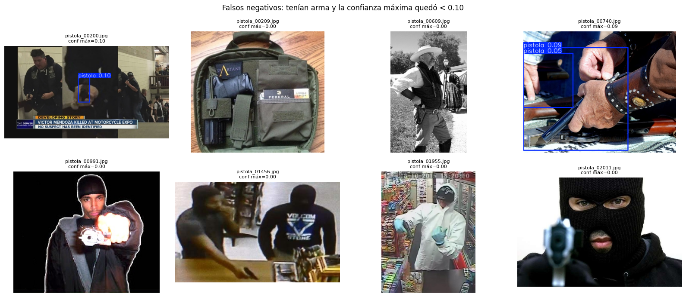
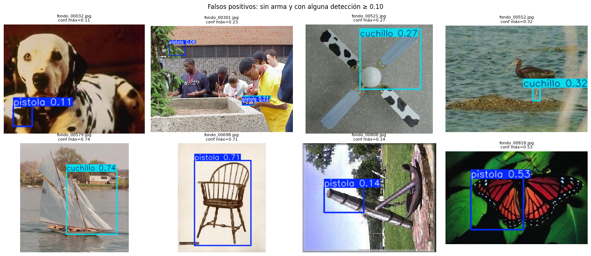
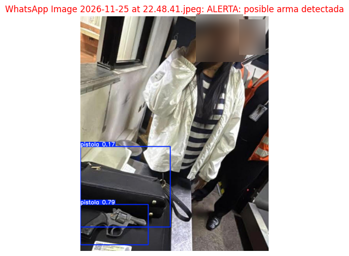

# Prototipo de sistema de reconocimiento de objetos en imágenes. Caso particular: detección de armas
This project is a part of the **Proyecto 1 de Innovación Tecnológica** course in the Applied Artificial Intelligence Master, Universidad Icesi, Cali Colombia.

#### -- Project Status: Completed

## Contributing Members

**Team Leader: Jhon Fredy Montenegro Rosero** (jhon.montenegrorosero@u.icesi.edu.co)

## Contact
* Para preguntas sobre el proyecto o para contribuir, escriba a jhon.montenegrorosero@u.icesi.edu.co.

## Project Intro/Objective
El propósito de este proyecto es desarrollar un prototipo que detecte armas en imágenes mediante aprendizaje profundo y emita una alerta temprana, para apoyar la videovigilancia en entornos urbanos de Colombia. Hoy el video de las cámaras se revisa de forma manual y sirve sobre todo como evidencia posterior: según la Encuesta de Convivencia y Seguridad Ciudadana del DANE, el 52.9 % de las personas de 15 años y más se sintió insegura en su ciudad o municipio en 2022. El prototipo busca demostrar que, con datos públicos y una GPU gratuita en la nube, es posible construir un detector con un desempeño medido en datos independientes. El sistema se plantea como apoyo al operador humano, que verifica cada alerta, y no como un mecanismo que actúe por sí solo.

### Methods Used
* Deep Learning (redes neuronales convolucionales)
* Object Detection (detector de una etapa YOLO)
* Transfer Learning (pesos preentrenados en COCO)
* Data Augmentation
* Model Evaluation (precisión, recall, F1, mAP, barrido de umbral, pruebas de robustez)
* Data Visualization
* Metodología ágil (Scrum)

### Technologies
* Python 3.13
* PyTorch 2.14 + CUDA 13.0
* Ultralytics YOLO11 (8.4.219)
* OpenCV, Pillow
* NumPy, pandas, Matplotlib
* Jupyter / Google Colab (GPU NVIDIA Tesla T4)
* Git (*sparse checkout*)

## Project Description

### Datos
Se usa el conjunto público [Detección de Armas Open Data](https://dasci.es/opendata/deteccion-de-armas-open-data/) del instituto DaSCI de la Universidad de Granada (repositorio [ari-dasci/OD-WeaponDetection](https://github.com/ari-dasci/OD-WeaponDetection), licencia CC BY-SA 4.0). El notebook descarga solo tres carpetas:

| Subconjunto | Contenido | Uso |
|---|---|---|
| `Pistol detection` | 3000 imágenes con cajas en formato Pascal VOC | Clase `pistola` |
| `Knife_detection` | 2078 imágenes con cajas en formato Pascal VOC | Clase `cuchillo` |
| `Pistol classification` | Objetos cotidianos de Caltech-101 (102 categorías) | Negativos (100 categorías, sin `AAAPistol` ni `cannon`) |

### Preparación del conjunto
1. Lectura de cada XML (Pascal VOC) y emparejamiento con su imagen.
2. Conversión de cada caja al formato YOLO normalizado, recortada al borde de la imagen; se descartó una caja degenerada.
3. Adición de 1015 imágenes sin arma (0.20 por cada imagen con arma) como negativos con etiqueta vacía, repartidas entre 100 categorías.
4. Eliminación de 13 duplicados exactos por MD5, para que una imagen no quede en entrenamiento y en prueba a la vez.
5. Partición 80/10/10 estratificada por origen, con semilla 42.
6. Verificación visual de las cajas antes de entrenar.

| Partición | Pistola | Cuchillo | Fondo | Total |
|---|---:|---:|---:|---:|
| Entrenamiento | 2389 | 1662 | 812 | 4863 |
| Validación | 298 | 207 | 101 | 606 |
| Prueba | 300 | 209 | 102 | 611 |
| **Total** | **2987** | **2078** | **1015** | **6080** |

En total hay 5604 cajas: 4499 en entrenamiento, 541 en validación y 564 en prueba (344 de pistola y 220 de cuchillo).



*Verificación visual de las etiquetas: pistola (rojo), cuchillo (naranja) e imágenes de fondo sin cajas.*

### Modelo y entrenamiento
* **Modelo:** YOLO11s preentrenado en COCO (9.43 M parámetros, 21.7 GFLOPs); la cabeza pasa de 80 a 2 clases.
* **Configuración:** imágenes de 640 × 640 px, lotes de 16, 60 épocas, parada temprana con paciencia de 15, AdamW con tasa coseno, semilla 42 en modo determinista.
* **Aumentación:** la de Ultralytics por defecto (mosaico, volteo horizontal, escala, traslación, color), más variación de brillo (`hsv_v=0.5`), rotación de ±5° y `mixup=0.1`.
* **Resultado:** 60 épocas completas en 1.461 h en una Tesla T4. La última época fue la mejor (mAP@0.5:0.95 de 0.672 en validación).



*(a) Pérdidas en entrenamiento; la línea punteada marca la desactivación del mosaico. (b) Métricas en validación.*



*Predicciones del modelo sobre un lote de validación.*

### Resultados en el conjunto de prueba (611 imágenes no usadas en el entrenamiento)

**Métricas por caja (detección)**

| Clase | P | R | F1 | mAP@0.5 | mAP@0.5:0.95 |
|---|---:|---:|---:|---:|---:|
| Pistola | 0.920 | 0.838 | 0.877 | 0.897 | 0.707 |
| Cuchillo | 0.949 | 0.927 | 0.938 | 0.972 | 0.637 |
| **Todas** | **0.934** | **0.882** | **0.908** | **0.935** | **0.672** |



*Matriz de confusión normalizada del conjunto de prueba (Ultralytics): no hay confusiones entre pistola y cuchillo.*

**Métricas por imagen ("¿hay un arma en la imagen?")**

Es la decisión que toma el servicio de alertas. Se probaron umbrales de confianza de 0.10 a 0.90 y se eligió el de mayor F1: **0.10**.

| Umbral | P | R | F1 | Exactitud | VP | FP | FN | VN |
|---|---:|---:|---:|---:|---:|---:|---:|---:|
| **0.10** | **0.980** | **0.974** | **0.977** | **0.962** | 496 | 10 | 13 | 92 |
| 0.30 | 0.990 | 0.951 | 0.970 | 0.951 | 484 | 5 | 25 | 97 |
| 0.50 | 0.994 | 0.912 | 0.951 | 0.921 | 464 | 3 | 45 | 99 |



*Precisión, recall y F1 a nivel de imagen según el umbral de confianza.*

**Robustez ante imágenes degradadas (umbral 0.10)**

| Condición | P | R | F1 | FP | FN |
|---|---:|---:|---:|---:|---:|
| Original | 0.980 | 0.974 | 0.977 | 10 | 13 |
| Oscura (× 0.35) | 0.969 | 0.976 | 0.973 | 16 | 12 |
| Desenfocada (9 × 9) | 0.917 | 0.974 | 0.945 | 45 | 13 |
| Baja resolución (1/4) | 0.938 | 0.947 | 0.942 | 32 | 27 |
| Ruido (σ = 20) | 0.939 | 0.945 | 0.942 | 31 | 28 |

**Tiempo de procesamiento:** 15.7 ms por imagen en promedio (percentil 95: 24.3 ms), unas 64 imágenes por segundo en una Tesla T4.

### Análisis de errores



*Falsos negativos: pistolas vistas de frente, dentro de un bolso o una funda, o pequeñas en escenas de cámaras de seguridad.*



*Falsos positivos: objetos con formas alargadas o contornos parecidos a un arma (mástil de velero, silla, mariposa).*

### Servicio de detección
La función `detectar_armas()` recibe una imagen y devuelve si hay arma, la lista de detecciones (clase, confianza y caja en píxeles), el tiempo de procesamiento y la imagen anotada. En Colab, el usuario sube una o varias imágenes y el sistema muestra «ALERTA: posible arma detectada» o «Sin armas detectadas».



*Prueba con una fotografía externa: alerta en 31.6 ms, revólver detectado como pistola con confianza 0.79 (rostros difuminados).*

### Retos y limitaciones
* Los negativos provienen de Caltech-101 (objetos bien encuadrados sobre fondos simples); en cámaras reales la tasa de falsas alarmas puede ser mayor.
* Con 10 falsas alarmas en 102 imágenes sin arma, el análisis de video cuadro a cuadro requiere confirmación temporal antes de un despliegue.
* El umbral se eligió sobre el conjunto de prueba; lo correcto en una siguiente etapa es elegirlo en validación.
* Las armas pequeñas, ocultas o vistas de frente y las imágenes de baja resolución concentran los errores.
* No se usaron datos de cámaras colombianas; su uso debe cumplir la Ley 1581 de 2012 de protección de datos personales.

## Getting Started
Instructions for contributors
1. Clone this repo (for help see this [tutorial](https://help.github.com/articles/cloning-a-repository/)).
2. Raw Data is not stored in this repo: el notebook descarga automáticamente las carpetas necesarias del repositorio [ari-dasci/OD-WeaponDetection](https://github.com/ari-dasci/OD-WeaponDetection) mediante *git sparse checkout* (unos 1 GB).
3. Data processing, training, evaluation and the detection service are in a single notebook: [`Dect_Armas_ProFinal.ipynb`](Dect_Armas_ProFinal.ipynb).
4. Abra el notebook en Google Colab y active la GPU: *Entorno de ejecución → Cambiar tipo de entorno → GPU T4*.
5. Ejecute las celdas en orden:
   * **Sección 0. Configuración:** todos los parámetros ajustables (`MODEL_NAME`, `EPOCHS`, `INCLUDE_KNIVES`, `NEG_RATIO`, `USE_DRIVE`, etc.). Con `USE_DRIVE = True` los pesos se guardan en Google Drive.
   * **Sección 1. Obtención de las imágenes.**
   * **Sección 2. Preparación del dataset en formato YOLO.**
   * **Sección 3. Entrenamiento** (unos 90 min en una T4).
   * **Sección 4. Evaluación** en el conjunto de prueba, calibración del umbral y prueba de robustez.
   * **Sección 5. Servicio de detección:** suba sus imágenes y obtenga la alerta.
6. Si ya entrenó con Drive activado, basta con ejecutar la sección 0, el montaje de Drive y la sección 5.

### Estructura del repositorio
```
├── Dect_Armas_ProFinal.ipynb                 # Notebook final: datos, entrenamiento, evaluación y servicio
├── README.md
└── docs/
    └── img/                                      # Figuras del notebook usadas en este README
```

## Featured Notebooks/Analysis/Deliverables
* [Notebook final: detección de armas con YOLO11s](Dect_Armas_ProFinal.ipynb)
